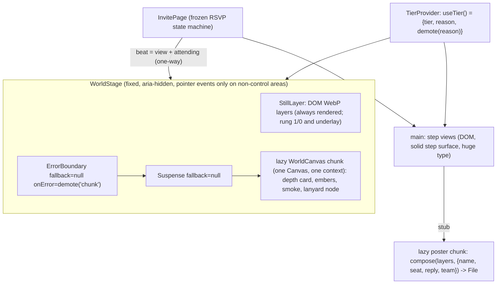
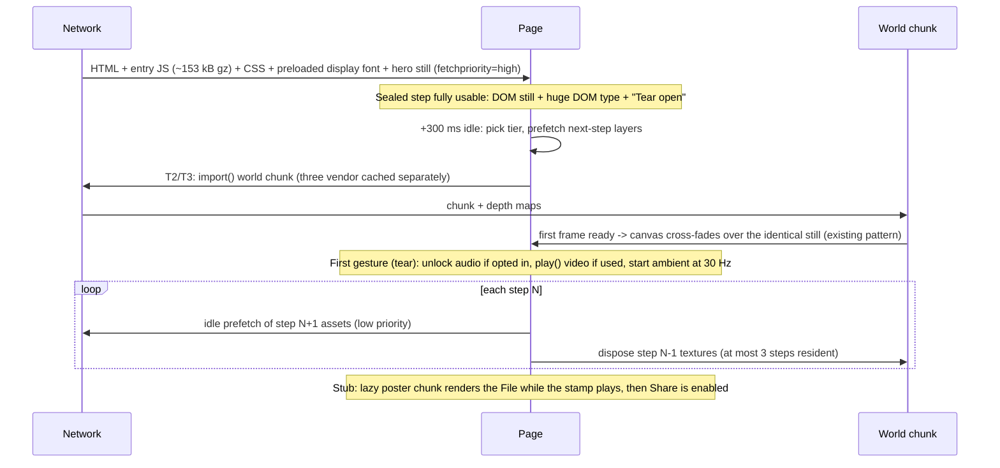

# Atlas: render budget and architecture for the cinematic poster redesign of Thirty United

Analysis only. I changed no files and did not create ARCHITECTURE.md, because no direction has been picked (`chosenDirection: null`). Once one is picked I'll write it.

## 0. What I read, and three framing corrections

**Read:**
- `netlify.toml` (CSP)
- `vite.config.ts` (no `manualChunks`)
- `package.json` (three 0.186, R3F 9, motion 14; no drei, no postprocessing)
- `src/components/InvitePage.tsx`, `SealedView.tsx`, `three/LanyardTicket.tsx`, `sceneTextures.ts`, `ticketTexture.ts`, `DebugOverlay.tsx`, `ErrorBoundary.tsx`, `lib/webgl.ts`, `lib/motionPrefs.ts`, `lib/sound.ts`, `StubView.tsx`, `main.tsx`, `index.html`
- `.specno-design/direction.md`, `references/immersive-night-world-rsvp-2026-10-15.md`, `lux-notes/save-the-date-stadium-options.md`, `lux-notes/save-the-date-3d-lanyard-spec.md` (budgets and slow-frame rule), `captures/save-the-date-verify-stadium-2026-10-14.md`, `brand.md`, `.agents/specno-design.json`
- three's `GLTFLoader`, `KTX2Loader`, `DRACOLoader`, `meshopt_decoder`, `ImageBitmapLoader` source, to check CSP behaviour

There is no `.atlas`, no Archon brief and no ARCHITECTURE.md.

**Framing corrections:**

1. **This brief isn't any of the three directions in `direction.md`.** The brief asks for an anime matchday poster: a hero figure, moon, smoke, embers and huge type. `direction.md` has a miniature turntable (A), a first-person walk-out (B) and a fixed-camera dusk scene (C). Their render-cost sections don't carry over. These still apply from the contract:
   - the 3-rung fallback ladder
   - journey rules: a plain DOM control completes every step, and text never sits on the moving scene
   - Convex is frozen, and a guest only ever sees their own data
   - the AA contrast floor
   - `brand.md:35`: "No official club crest, wordmark or kit, ever".

   The round-2 lux rule "nothing loops" is marked *in question*. I cost it as an open decision below and don't decide it.
2. **Make the painted 2D poster layers the source of truth, with WebGL as an enhancement of them.** The hero is an AI-generated 2D image. A depth-displaced card of that image will look more like the poster than any 3D rebuild of it. The same layers then serve as rung 2, the reduced-motion rung and the input to the per-guest poster. **This is the hard-to-reverse decision.** It fixes the art pipeline, the asset effort and every fallback rung.
3. **The real cost fork is `frameloop="demand"` versus a continuous loop, not triangles.** Today nothing renders at rest (`LanyardTicket.tsx:325`). Embers, smoke, drifting motes, an idle breathing rig and animated grain all force a continuous loop. That costs battery and heat and causes throttling, and it raises the chance the WebGL context is lost when the guest switches to their email app for the code. So below, every technique's first cost line is "forces a continuous loop: yes/no".

**The WhatsApp WebView assumption may be too pessimistic.** I couldn't confirm that consumer WhatsApp opens person-to-person links in a WebView. The only current source I found is a third-party summary (wati.io) of Meta's in-app browser rollout. It says the in-app browser applies to CTA-button links in business template messages, and that links in free-form messages open in the default browser. That's about the Business API, not consumer chats, so it doesn't settle it. I treat the WebView as the **conservative floor**. Open the link from WhatsApp on a real phone with `?debug=1`: the existing overlay prints the user agent (`DebugOverlay.tsx:36`), and that answers it.

**Screen math used throughout:** a 390×844 CSS viewport at DPR 1.5 is 585×1266, about 0.74 MP. At DPR 1 it's about 0.33 MP. An iPhone at DPR 2 is about 1.3 MP. On a Mali-G57-class GPU, **fill rate is the limit**: keep total shaded pixels per frame to roughly 4–6× the screen area at DPR 1.5. All millisecond figures are estimates to measure on the device with the debug overlay; none are measurements.

---

## 1. Technique by technique

### 1. Layered 2.5D parallax

| | 1a: DOM layers (CSS transforms on 4–6 WebP layers) | 1b: WebGL depth-map card (colour plus depth texture, UV offset or a displaced grid) |
|---|---|---|
| Forces a continuous loop | No: it moves on touch or scroll only | No, if driven by input with `invalidate()`. Yes, if the camera "breathes" at idle |
| Frame cost | Compositor only, about 1–2 ms | About 1–2 ms fragment work at 0.74 MP; 1 draw call per layer (2–4 total) |
| Download | 0.4–0.8 MB of WebP layers at 1080 wide; 720 wide for low tiers. Zero JS (motion is already in the entry) | The same layers plus depth maps of 100–200 kB, inside the existing three chunk (+3–5 kB of shader) |
| Memory | Each decoded 1080×1920 layer is about 8.3 MB, so 5 layers are about 40 MB | Colour 1080×1920 is about 11 MB with mips; a 2048×3600 texture would be about 29 MB plus mips. Cap Android at 1024–1080 wide. Uncompressed, because KTX2 needs wasm |
| Mobile risk | Low | Low to medium: stretching at depth edges (hair, shoulders). Fix it by cutting the hero onto its own layer and inpainting the background behind him. Depth maps are made offline (for example Depth Anything), never at runtime |
| CSP change | None | None |
| Fallback | A flat, flattened still | Option 1a, then the still |

On gyro: iOS needs `DeviceOrientationEvent.requestPermission()` on a gesture, and support inside a WebView isn't guaranteed. Use touch-drag or scroll as the input; treat gyro as an optional Android-only extra.

### 2. Video cinemagraph loops

- **Codec:** H.264 MP4 is the only single universal file. Optionally add an HEVC source for iOS (about 40% smaller). Skip AV1: many mid-range SoCs have no hardware AV1 decode, so it falls back to software decoding at a battery cost.
- **Size:** a 720×1280 loop of 4–6 s with motion only in parts of the frame, at about 0.8–1.5 Mbps, is **0.5–1.1 MB per loop**.
- **Forces a continuous loop:** yes, video decode runs continuously. As a DOM layer the compositing cost is about 1–2 ms with hardware decode. As a WebGL `VideoTexture` it costs another 1–3 ms per frame on Android for the texture upload.
- **Memory and decoders:** about 20–50 MB per decoder. Android has a small, device-dependent limit on concurrent hardware decoders, so **play one video at a time**.
- **Autoplay risk (high, and it decides the design):**
  - It needs `muted playsinline autoplay`.
  - iOS Low Power Mode blocks autoplay.
  - Android WebView's `mediaPlaybackRequiresUserGesture` setting may block even muted autoplay. Verify on a device.
  - On iPhone, a WKWebView whose host app doesn't allow inline playback can force fullscreen. Verify.

  The rule that follows: show the `poster` frame as the image, call `play()` only after the first gesture (the tear), and catch `NotAllowedError` by staying on the still. Use `preload="none"` until the tier is known.
- **Alpha video:** HEVC-with-alpha works only on Safari and VP9-alpha WebM only on Chromium, so that's two encodes and two pipelines. A cross-platform alternative is a stacked colour-plus-alpha H.264 file split in a WebGL shader (twice the height, needs WebGL). **Better: avoid alpha altogether.** Smoke, embers and flares are additive light, so render them on black and composite with `mix-blend-mode: screen` (DOM) or additive blending (GL).
- **CSP:** none for same-origin MP4, because `media-src` falls back to `default-src 'self'`. Only MSE or HLS (`blob:`) would need `media-src blob:`, so avoid them. Also confirm that Netlify answers byte-range requests with 206, which iOS needs for video.
- **Fallback:** the poster still.

### 3. Full real-time 3D stadium, toon-shaded, with volumetric cones

- **Forces a continuous loop:** only if something is animated (crowd, flicker, haze). Camera moves between steps can stay on demand.
- **Cost:**
  - 30–80 draw calls and 30–80k triangles.
  - `MeshToonMaterial` itself is cheap. Outlines are not: inverted-hull outlines double the draw calls, and a post-process edge pass needs a depth/normal buffer plus a full-screen pass.
  - True raymarched volumetric cones (4 lights × full screen × 16–32 steps) would take an estimated 10–30 ms on a G57, which is the whole budget. **Rule them out.** Fake the cones with additive cone meshes using a fresnel fade and scrolling noise, about 0.5–1.5 ms each depending on how much screen they cover.
- **Download:** about 10–30 kB of scene code plus about 12 kB gz for `GLTFLoader`. Assets are 0.3–0.8 MB of glTF plus 0.3–0.6 MB of lightmaps (baked lightmaps, as `direction.md` already specifies).
- **Effort:** 2–5 days of 3D work.
- **Mobile risk:** medium to high. **Style risk: high.** A real-time toon stadium and a painted anime poster are two art directions that won't match.
- **CSP:** none if it's procedural or plain glTF with external WebP textures (see 4).
- **Fallback:** stills rendered from the same scene.

### 4. GLB character from image-to-3D, rigged or static

- **Pipeline:** a raw image-to-3D output of 100–500k triangles, decimated to 15–30k, with a 2048 WebP texture (300–600 kB). That's 0.5–1.5 MB as plain quantised glTF, or 0.3–0.6 MB with meshopt (which needs wasm).
- **Runtime:** one skinned draw call; GPU skinning costs about 0.2 ms. Each animation clip is 50–200 kB. **A rigged idle loop forces a continuous loop.**
- **Risk: high, on quality rather than performance.** Image-to-3D loses the owner's likeness (face and hands go soft) and only reads from the front. Limit it to ±10° and you have what a depth card gives for a fraction of the cost. **I recommend against it.**
- **CSP traps, checked in the r186 source:**
  - A GLB with embedded images goes through `URL.createObjectURL` (`GLTFLoader.js:3368`). On Chromium and Safari 17+ that blob is loaded by `ImageBitmapLoader` through `fetch()` (`ImageBitmapLoader.js:173`), which needs `connect-src blob:`. Otherwise `TextureLoader` loads it, which needs `img-src blob:`. **You can avoid both by shipping `.gltf` with external same-origin `.webp` textures** (`EXT_texture_webp`).
  - Draco and KTX2 each build a blob worker (`DRACOLoader.js:426/440`, `KTX2Loader.js:329/334`) and need wasm, so they need `worker-src blob:` plus `'wasm-unsafe-eval'`.
  - Meshopt always needs wasm (`meshopt_decoder.module.js:30`). Its worker is optional and would also need `blob:`.
- **Fallback:** the 2D hero layer.

### 5. Gaussian splats

- **Source mismatch:** splats come from captures or generated 3D scenes and look photographic. An anime poster isn't a natural source.
- **Size:** about 32 bytes per splat in `.splat` format, so 1M splats is about 32 MB. A mobile-sized 200–300k splats in `.spz` is about 5–8 MB. GPU memory is roughly 64+ bytes per splat once decoded.
- **Per frame:** a depth sort whenever the camera moves (about 5–15 ms of worker time for 500k splats on a mobile CPU) plus heavy overdraw. Expect roughly 15–25 fps on a mid-range Android at 300k splats. Library bundles add about 80–200 kB gz.
- **CSP:** the mainstream libraries (Spark, GaussianSplats3D) need `'wasm-unsafe-eval'` and `worker-src blob:`. Verify for whichever library you pick.
- **Risk:** very high. On a 4 GB device, memory pressure is likely to kill the page.
- **Verdict: reject.** If the owner insists: hero only, under 200k splats, top tier only, with the same 2D rung.

### 6. Post-processing chain

- **Forces a continuous loop:** animated grain does; static bloom and vignette don't.
- **Cost estimates at 0.74 MP on a G57:**
  - rendering the scene into a texture: +0.5–1 ms, and you lose canvas MSAA unless the target is multisampled
  - bloom mip chain: 2–4 ms
  - grain, chromatic aberration, vignette and tone mapping merged into one pass (pmndrs `postprocessing` merges them): 0.7–1.5 ms
  - god rays (a radial blur of 30–60 samples): 3–8 ms. **Fake them with beam cards or paint them into the art.**
- **Memory:** an RGBA16F target is about 6 MB, so about 20 MB for ping-pong buffers plus the bloom chain. Bloom needs half-float render targets (WebGL2 or `EXT_color_buffer_half_float`).
- **Download:** pmndrs `postprocessing` adds about 50–90 kB gz (an estimate; measure it). The three/examples `EffectComposer` and `UnrealBloomPass` are smaller, about 15–25 kB.
- **Cheaper route:** paint the bloom and glow into the poster layers. Do the vignette as a CSS radial-gradient and the grain as a static tiled image over the scene. Skip chromatic aberration or bake it in. Allow real bloom only on the top tier, at half resolution.
- **CSP:** none (GLSL strings, no eval).
- **Fallback:** the baked glow that's already in the art.

### 7. GPU particles: embers and smoke

- **Embers:** one `Points` draw call with motion computed from time in the vertex shader (no CPU update per frame). 300–1500 particles, additive. About 0.2–0.6 ms and a buffer of about 30 kB. **Forces a continuous loop.**
- **Smoke as many large soft sprites is what kills a Mali GPU.** Twenty sprites each covering 30% of the screen is 6× overdraw, an estimated 4–8 ms. Instead use 2–3 quads with a scrolling tiling noise texture (512², about 40 kB WebP), which is 2–3× overdraw and about 1–2 ms. Or use a screen-blended video loop (2), or a static painted layer on low tiers.
- **Below WebGL:** a 2D canvas with 80–150 embers costs about 1–2 ms of CPU, or use 15–25 CSS-transformed elements. Both still run as loops.
- **CSP:** none.
- **Fallback:** painted embers in the still.

### 8. Chapter transitions between RSVP steps

- **DOM:** motion is already in the entry, so 0 kB extra. Animate only transform and opacity on the step panel, 200–400 ms. Keep the existing `useFocusOnMount` and `Announcer`.
- **View Transitions API:** a progressive enhancement only (Chromium and WebView; Safari 18+). Each snapshot is about one screen of RGBA. Feature-detect it.
- **WebGL:** transitions should be tweens of world state (camera, light uniforms, layer offsets) inside **one persistent canvas**, rendered on demand only during the 600–1200 ms tween. Render-target wipes or dissolves render both scenes, so they cost twice the scene plus two full-screen targets (about 12 MB). Avoid them on Android tiers.
- **Never remount the canvas between steps.** Context creation takes about 50–200 ms, and browsers cap live contexts.
- **CSP:** none.
- **Fallback:** an instant swap under reduced motion.

### 9. Per-guest poster generation in the browser

- **Render:** a main-thread canvas at 1080×1920 (story) or 1080×1350 (4:5, friendlier for WhatsApp). The backing store is about 8.3 MB.
  - Draw the same WebP layers as rung 2 (use `img.decode()` or `createImageBitmap` first). Then draw text after `document.fonts.load(...)`, the pattern already in `ticketTexture.ts:11-23`.
  - About 100–300 ms, one time. Same-origin images don't taint the canvas.
- **Encode:**
  - Use **JPEG at about q0.88**: about 250–600 kB, encoded in about 50–150 ms.
  - PNG of a painted 1080×1920 image would be about 3–5 MB and take about 0.5–1.5 s on a mid-range Android.
  - WhatsApp re-encodes to JPEG anyway, so PNG is wasted. PNG only makes sense if a crisp-type master really matters.
- **Share (an architectural point): render the poster *before* the tap.** `navigator.share()` has to run inside the gesture's user activation, and Safari is strict about that. If you await a 300 ms render first, the share call can fail. So build the `File` while the stamp animates, enable the button when it's ready, and call `share` synchronously in the click handler.
- **Support:** file sharing works on Safari iOS 15+ and Chrome Android. I believe Android WebView has no `navigator.share` at all (check MDN compat), and WKWebView support depends on the host app. Always check `navigator.canShare({ files })`.
- **Fallback ladder:**
  1. Web Share with the file.
  2. An inline `` from a `data:` URL with "Press and hold to save". This works everywhere and needs no CSP change.
  3. `<a download>` (unreliable in WebViews).
  4. "Open in your browser" copy.
- **Showing the result:** use a `data:` URL (already allowed). A `blob:` URL would need `img-src blob:`.
- **If guests can add their own photo:** read it with `<input type=file>` and `createImageBitmap(file)`, which needs no `blob:` URL and no CSP change, and never upload it. I believe `Permissions-Policy: camera=()` blocks `getUserMedia` but not the file picker; verify on a device.
- **OffscreenCanvas in a worker:** a reversible optimisation, and not needed for a single render. Font support inside workers is patchy on Safari. A Vite file worker needs no CSP change because `worker-src` falls back to `script-src 'self'`, but the `?worker&inline` form would need `blob:`.
- **Server-side rendering** (a Netlify function with satori or resvg): rejected. It adds an endpoint and puts guest names on a server, while the client gives the same result.
- **Every tier gets the same poster**, because it composites the 2D layers. A reduced-motion guest gets an identical image.

### 10. WebAudio soundscape

- **Today:** synthesized only, opt-in, off by default, no media files (`sound.ts:3`).
- **Format:** a soundscape means media files. Use AAC `.m4a` or MP3; iOS has no Ogg Vorbis.
- **Sizes:** a 20 s mono loop at 64 kbps is about 160 kB. Stingers are 10–30 kB each.
- **Memory trap:** `decodeAudioData` expands to float32 PCM. 20 s mono at 48 kHz is about 3.8 MB; 60 s stereo is about 23 MB.
  - Use short `AudioBufferSourceNode` loops: they loop without a gap, whereas `<audio loop>` leaves a gap on iOS.
  - For a long bed, use an `<audio>` element with `MediaElementAudioSourceNode`, which streams.
- **Behaviour:**
  - CPU cost is negligible.
  - Suspend the context on `visibilitychange`.
  - The iOS silent switch mutes Web Audio; respect that and don't set `audioSession`.
  - Fetch audio only when the guest switches sound on.
- **Forces a continuous render loop:** no. Audio runs on its own thread.
- **CSP:** none (same-origin `fetch` uses `connect-src 'self'`; `<audio>` uses `media-src` through `default-src`).
- **Fallback:** silence.
- **For the designer:** `unlockAudio()` also turns sound off under reduced motion (`sound.ts:47`). That ties two unrelated preferences together. It needs a decision, not a silent change.

### Huge type

Huge type is **DOM text, never a texture**: it costs nothing to render, keeps AA, stays zoomable and is read by screen readers. Canvas text belongs only in the poster generator. The conflict to flag to pixel: the journey rules say text never sits on the moving scene, but the poster look puts display type over the art. A way to reconcile them: display type can sit over the still or slowly drifting art if a scrim painted into that region guarantees contrast, and the form text stays on the solid step surface.

---

## 2. The forks that matter

### Fork A: art pipeline (hard to reverse)

| | A1: painted 2.5D layers + WebGL enhancement (**recommend**) | A2: a video cinemagraph per step over DOM | A3: a modelled 3D stadium world |
|---|---|---|---|
| Matches the anime poster | Best: it *is* the poster | Good | Weak: two art styles |
| Asset effort | Paint and split layers, offline depth maps, 1–2 days | Generate or render loops, 1–3 days, plus encoding | 2–5 days of 3D plus baking |
| Extra download | 0.5–1.2 MB | 0.5–1.1 MB per step | 0.7–1.5 MB |
| Mobile risk | Low | Medium to high (autoplay policies) | Medium to high (fill rate) |
| Rung 2/3 and poster parity | The same files | Uses the poster frames | Needs separate stills |
| CSP | None | None | None if it's plain glTF with external WebP |

A1 and A2 also combine well: the depth-card layers, plus one screen-blended smoke/ember loop on the top tier.

### Fork B: what happens to the existing lanyard

| Option | Trade-off |
|---|---|
| B1: keep its own canvas over a world canvas | Two live WebGL contexts at once, so twice the context memory and a higher chance of context loss. Simplest code change. |
| B2: make it a node inside the single world canvas (**recommend if the ticket stays**) | One context. The `settleRef` hand-off pattern carries over. A medium refactor of `LanyardTicket.tsx`. |
| B3: retire it, so the poster replaces the ticket as the object | Least code. A design decision for pixel and the owner. |

### Fork C: ambient motion (this is the open "nothing loops" lux rule)

| Option | Trade-off |
|---|---|
| C1: continuous at display rate | Most cinematic. Worst for battery, heat and context loss. |
| C2 (**recommend**): ambient effects at 30 Hz | Keep `frameloop="demand"` and call `invalidate()` on a timer. Interaction and transitions run at full rate. Ambient motion pauses when the page is hidden and on the code step. That roughly halves the GPU work. |
| C3: one-shot effects only (today's rule) | Cheapest. Least "go all out". |

### Fork D: poster output

| Option | Trade-off |
|---|---|
| D1 (**recommend**): client canvas → JPEG `File` → Web Share, with the long-press `` fallback | No backend change and no CSP change. |
| D2: server render | Rejected (PII on a server, new surface, Convex frozen). |
| D3: no image, only a "screenshot this" prompt | Cheapest, but weak. |

---

## 3. Structure: where this sits relative to the lazy-chunk/ErrorBoundary pattern

The world has to persist across 4–5 steps. So the canvas must mount at **InvitePage level, as a sibling of `<main>`**, outside the keyed `view-enter` div (`InvitePage.tsx:145`). Today it's inside SealedView, and the page's `stage`/`stageOn` logic (`InvitePage.tsx:74,135-142`) is the precursor of this.

Lift SealedView's `lanyard` state, `failLanyard`, the `webglcontextlost` handler and the spec's slow-frame demotion into one page-level stage controller:

**Contracts:**
- `WorldStage` is a pure function of `beat` and `tier`. It never owns RSVP state and never shows another guest's data. The guest's own `ticketNo` may drive their seat.
- Step views read `useTier()` only for chrome, such as hiding a Quality chip.
- The poster generator is a pure async function, `(layers, guestFields) → File`, in its own lazy chunk.
- Keep the DOM ticket rule from `SealedView.tsx:308`: the canvas is decoration over a complete DOM page, with one ErrorBoundary (`fallback={null}`) around one lazy world chunk. The verify report's HIGH defect (a chunk failure taking down the page) is exactly what this placement prevents.
- In `vite.config.ts`, add `build.rollupOptions.output.manualChunks` to split the `three`/R3F vendor code (about 246 kB) from the scene code, so the vendor chunk stays cached across deploys. Also add an immutable Cache-Control header for `/assets/*` in `netlify.toml` (the hashed files). Both are easy to undo.
- Extend `?debug=1` to print the chosen tier, why it was chosen, each demotion, fps and the user agent. It's the only instrument you'll have inside WhatsApp.

**Leaving for the email code (a new risk this redesign raises):** the code step sends the guest to their email app. On a 4 GB Android, a heavier world makes context loss or a discarded tab more likely while they're away.
- On `visibilitychange` hidden during the code step, stop the loop and release large textures. On `webglcontextlost`, demote to the still layer, which has the same composition, so the swap is close to invisible.
- **Existing gap (not part of this change, a follow-up for nova):** after a tab discard, the guest lands back on the **form**, not the code step. `InvitePage.tsx:66` restores only the answers, and `CodeState` isn't persisted. They then request a new code and may hit the rate limit. The redesign makes that path more likely.

---

## 4. Device tiers and the fallback ladder

**Picking the starting tier** (at the existing 300 ms idle warm-up, `InvitePage.tsx:78-84`): extend `hasWebGL()` (`lib/webgl.ts`) to require WebGL2 and read these signals:
- `MAX_TEXTURE_SIZE`
- the unmasked renderer string. This works on Android (Mali/Adreno names) but is masked to "Apple GPU" on iOS.
- `navigator.deviceMemory`, which Safari doesn't expose
- `hardwareConcurrency`
- `navigator.connection.saveData`
- the media queries `prefers-reduced-motion`, `forced-colors` and `prefers-reduced-data`

A table of about 10 lines of regexes is enough. **Don't use `detect-gpu`**: it fetches its benchmark data from a CDN by default, which would mean a `connect-src` change.

**Demoting at runtime:** keep the spec's existing rule (median frame time over 33 ms in a 1 s window for 2 consecutive windows, or 3 bad windows in total). Demote in this order:
1. drop bloom
2. DPR 1
3. halve the embers
4. drop the smoke
5. down to T1

Never promote within a session (it would oscillate). Store the tier in sessionStorage. Also offer a manual "Lite" chip, following Bruno Simon's Quality control. Context loss means T1 for the rest of the session.

| Tier | Who | Render | DPR | fps |
|---|---|---|---|---|
| **T3 Cinematic** | Apple GPU with WebGL2 (iPhone 11+); Adreno 7xx, Mali-G7x+ or Immortalis with `deviceMemory` ≥ 6 | Depth card(s), up to 1500 GPU embers, noise smoke, optional half-resolution bloom, ambient at 30 Hz (C2), optional cinemagraph | ≤ 2 on iOS, ≤ 1.5 on Android | 60 target, 45 floor |
| **T2 Lit** | Mali-G57/G68, Adreno 6xx, `deviceMemory` 4, or demoted from T3 | Depth card, up to 500 embers, 1 smoke layer, glow baked into the art, no post-processing | 1–1.25 | 45 target, 30 floor |
| **T1 Poster** | No WebGL2, `deviceMemory` ≤ 2, `saveData`, context loss, slow frames, chunk failure | DOM layer parallax on touch, up to 20 CSS embers or none, static grain | n/a | Compositor only |
| **T0 Still** | `prefers-reduced-motion` | T1 layers flattened: no parallax, no particles, no autoplay, instant swaps | n/a | n/a |
| **Forced colors** | `forced-colors: active` | All scene layers `display: none`, UI in system colours (as today, `index.css:446-454`). The poster generator stays available, since it's an image the guest asked for | n/a | n/a |

Because iPhone 11+ is far more capable than the Android target, don't hold it to the Android tiers. The tiers split along the Android line.

---

## 5. Loading choreography

- Preload the hero still with `<link rel="preload" as="image" imagesrcset fetchpriority="high">` in `index.html`. That needs no CSP change. Subset the display font as woff2.
- No canvas mounts and no media starts before idle, and video and audio wait for the first gesture.
- The still that paints first has the same composition as the world, so the switch to WebGL looks like the scene coming alive, not a swap.

---

## 6. Budgets per tier

All figures are estimates to confirm on a real phone with `?debug=1`.

| | Entry (all tiers) | T1/T0 total | T2 total | T3 total |
|---|---|---|---|---|
| JS gz loaded | ≤ 160 kB (153 today) | +0–10 kB (poster chunk) | +~260–275 kB (246 vendor + 15–30 scene) → about 430 kB in all | + post-processing 50–90 kB if bloom → about 510 kB in all |
| Before first interaction | ≤ 450 kB: JS, CSS, a display font ≤ 40 kB, hero still ≤ 120 kB at 720 wide (≤ 200 kB at 1080) | same | same | same |
| Total downloaded over the whole journey | n/a | ≤ 1.2 MB | ≤ 2 MB | ≤ 3.5 MB (audio 0.2–0.5 MB only if opted in; at most one video ahead of the current step) |
| GPU and decoded image memory | n/a | ≤ 60 MB | ≤ 120 MB | ≤ 200 MB |
| fps | n/a | compositor | 30 floor | 45 floor, 60 target |
| LCP target | ≤ 2.5 s on 4G | same | same | same |

---

## 7. CSP changes by option (for sentinel)

Current header (`netlify.toml:22`): `default-src 'self'; script-src 'self'; style-src 'self' 'sha256-…'; img-src 'self' data:; font-src 'self'; connect-src 'self' https://*.convex.cloud wss://*.convex.cloud; …`. There's no `media-src` or `worker-src`, so `media-src` falls back to `default-src 'self'` and `worker-src` falls back to `script-src 'self'`.

| Technique or option | Directive change | Why | Avoidable? |
|---|---|---|---|
| 2.5D layers (DOM or WebGL), particles, transitions, post-processing | **None** | Same-origin WebP; GLSL strings, no eval | n/a |
| Same-origin MP4 video | **None** (an explicit `media-src 'self'` is optional hygiene) | Falls back to `default-src` | n/a |
| MSE/HLS streaming | `media-src blob:` | MediaSource object URLs | Yes: use plain MP4 |
| GLB with embedded textures | `connect-src blob:` (ImageBitmapLoader `fetch`) **and/or** `img-src blob:` (TextureLoader) | `GLTFLoader.js:3368` `createObjectURL` | Yes: `.gltf` with external `.webp` |
| Draco geometry | `script-src 'wasm-unsafe-eval'` + `worker-src blob:` | `DRACOLoader.js:426,440` | Yes: plain quantised glTF |
| KTX2 / Basis textures | `script-src 'wasm-unsafe-eval'` + `worker-src blob:` | `KTX2Loader.js:329,334` | Yes: WebP, at a VRAM cost |
| Meshopt | `script-src 'wasm-unsafe-eval'` (+ `worker-src blob:` if `useWorkers`) | `meshopt_decoder.module.js:30,114` | Yes |
| Gaussian splats | `'wasm-unsafe-eval'` + `worker-src blob:` (+ possibly `connect-src blob:`); verify per library | Sorting in wasm and workers | Reject the technique |
| Poster preview via `blob:` | `img-src blob:` | Object URL in `` | Yes: a `data:` URL is already allowed |
| Guest photo via `createObjectURL` | `img-src blob:` | Object URL | Yes: `createImageBitmap(file)` |
| OffscreenCanvas worker (Vite file worker) | None (verify) | `worker-src` falls back to `script-src 'self'` | `?worker&inline` would need `blob:` |
| Audio files | None | `connect-src 'self'` / `media-src` via `default-src` | n/a |
| `detect-gpu` with its default CDN | `connect-src` + the CDN origin | Benchmark fetch | Yes: a home-grown heuristic |

For sentinel: `'wasm-unsafe-eval'` allows WebAssembly compilation only, not JS `eval`. It's still a posture change on a hardened header, so do it only if KTX2, Draco or meshopt is actually adopted. **The recommended path (A1 + C2 + D1) needs no CSP change at all.**

**Permissions-Policy:** `camera=()` stays as it is. Gyro parallax would need nothing (accelerometer and gyroscope aren't restricted), but iOS still shows a permission prompt.

---

## 8. Reversible versus hard to reverse

| Easy to reverse | Medium | Hard to reverse |
|---|---|---|
| Post-processing effects, particle counts, audio, transitions, tier thresholds, DPR caps, 30 Hz ambient, View Transitions, OffscreenCanvas, `manualChunks`, cache headers, depth card versus video on any one step (if both sit behind the same "step background" interface) | Moving the stage to page level and merging the lanyard into the world canvas (internal refactor); `color-scheme` light → dark (re-opens every AA and forced-colors check, as `direction.md` notes); a CSP relaxation once assets depend on it (undoing it means re-encoding every asset) | **The art pipeline (Fork A)**: it fixes asset effort, every fallback rung and the poster. **An image-to-3D likeness** of the owner. **Shared posters in the wild**: once guests post them, any IP or likeness problem can't be recalled. |

## 9. Flags for pixel and the owner (not decided here)

- **Trademark:** an AI-generated "Manchester United poster" will likely contain the crest, the kit sponsor or the wordmark. `brand.md:35` forbids all of these. Paint them out of the hero asset before it goes into layers, and above all before it can appear in a poster guests share. The owner needs to settle where the asset came from.
- **Huge type over the art** versus the journey rule that text never sits on the moving scene: see "Huge type" in section 1.
- **The lux rule "nothing loops"** is still open; Fork C costs the options.
- **Whether WhatsApp opens a WebView or the default browser:** settle it with `?debug=1` on a real phone before tuning the tiers.
- **Sound switched off under reduced motion** (`sound.ts:47`): it needs an explicit decision.

## Files

- /Users/makes/Documents/proj/thirty-united/netlify.toml
- /Users/makes/Documents/proj/thirty-united/vite.config.ts
- /Users/makes/Documents/proj/thirty-united/src/components/InvitePage.tsx
- /Users/makes/Documents/proj/thirty-united/src/components/SealedView.tsx
- /Users/makes/Documents/proj/thirty-united/src/components/three/LanyardTicket.tsx
- /Users/makes/Documents/proj/thirty-united/src/components/three/ticketTexture.ts
- /Users/makes/Documents/proj/thirty-united/src/components/three/DebugOverlay.tsx
- /Users/makes/Documents/proj/thirty-united/src/lib/webgl.ts
- /Users/makes/Documents/proj/thirty-united/src/lib/sound.ts
- /Users/makes/Documents/proj/thirty-united/.specno-design/direction.md
- /Users/makes/Documents/proj/thirty-united/.specno-design/lux-notes/save-the-date-3d-lanyard-spec.md
- /Users/makes/Documents/proj/thirty-united/.specno-design/brand.md

## Sources

- [Wati: Meta introduces the in-app browser (IAB) experience for WhatsApp](https://support.wati.io/en/articles/12867737-meta-introduces-in-app-browser-iab-experience-for-whatsapp) (third-party summary of the Business API rollout; it doesn't establish how consumer WhatsApp opens links)
